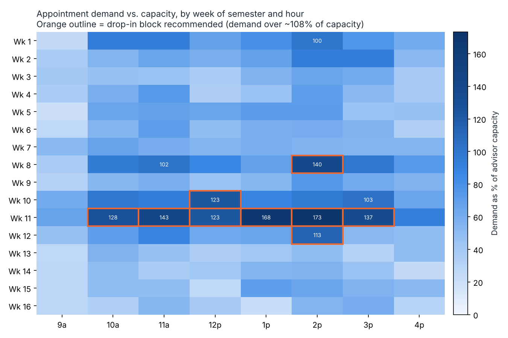

# Advising office: student records merge + appointment demand

> **Personal project.** Simulates a university advising office's records and appointment data. All students and records are synthetic.

Two problems an advising office really has:

1. **Three spreadsheets, one student.** The registrar, the advisors and the early-alert system each keep their own list, with different ID formats, name orders, nicknames, typos and repeats.
2. **Nobody knows when the rush is.** Students can't get appointments during registration week, while advisors sit idle in week 14.

## Results

| | |
| --- | --- |
| Rows in (3 files) | 9,440 |
| Unique students out | 4,142 (true answer: 4,139) |
| Duplicates removed | 5,298 |
| Merge precision | 100% (no two different people merged) |
| Merge recall | 99.96% (3 students split into two records, flagged for review) |
| Hand-typed rows with entry errors | 2,926 of 3,500, caught by `validate_entry.py` |

Precision and recall are measured against a hidden ground-truth file the generator writes. That's how you *prove* a dedupe works instead of eyeballing it.



Demand passes advisor capacity in **weeks 8, 10, 11 and 12** (midterms through registration), peaking at 173% at 2 p.m. in week 11. The plan in `outputs/drop_in_plan.csv` adds 9 drop-in blocks, about 80 advisor-hours a semester, exactly where the overflow is.

## Run it

```bash
python -m venv .venv && source .venv/bin/activate
pip install -r requirements.txt
python run.py                               # ~7 seconds
python -m pytest -q                         # 4 tests
python -m src.validate_entry data/advising_contacts.xlsx   # check a sheet before upload
```

## How the merge works (`src/merge.py`)

Normalize first: IDs to 7 digits (restores dropped leading zeros, strips the "NT" prefix), emails lowercased, phones to 10 digits, "LAST, First" split and title-cased, nicknames mapped (Jim → James).

Then match in passes, strictest first, recording *which rule* merged each row:

1. Same student ID
2. No ID → same email
3. No ID or email → same phone **and** same last name
4. Still unmatched → fuzzy name match (typos, nicknames) **plus** the same phone, with no conflicting email
5. Leftovers → grouped among themselves, flagged `needs_review`

Finally, a **golden record** per student takes each field from the most trusted source that has it (registrar > advising > early alert).

## Outputs (`outputs/`)

- `students_clean.csv` and `students.db`: one row per student, plus every source row with its match rule
- `entry_issues.csv`: every data-entry error, by Excel row number
- `drop_in_plan.csv`, `demand_heatmap.png`
- `powerbi/`: a star schema (`fact_appointment_requests`, `dim_date`, `dim_student`) that loads straight into Power BI or Tableau

## Interview talking points

- **Why is a name match not enough?** There are two Grace Walkers. An early version merged on name alone and precision dropped. The test `test_same_name_different_person_is_not_merged` guards against that now.
- **Why passes instead of one big fuzzy match?** Each merge is explainable ("matched by email"), and the risky rule only touches the few rows the safe rules couldn't place.
- **Why fix entry instead of cleaning forever?** Most errors come from one sheet typed by hand. A validator at upload time stops them at the source.

## Limitations

- Capacity assumes 5 advisors, 30-minute appointments, and 60% of advisor time bookable. Edit the constants in `src/demand.py`.
- The demand data counts requests, not completed appointments.
